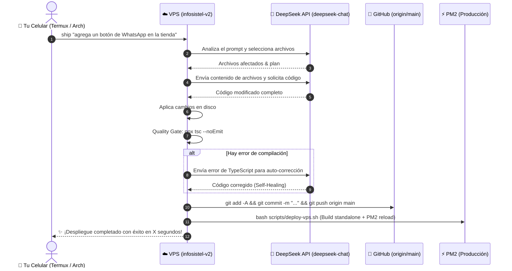

# 🚀 INFOSISTEL v2 - Mobile DevOps & Autonomous Ship Pipeline

Permite enviar órdenes (prompts) desde tu teléfono Android (con Termux o Arch Linux en Termux) para que la IA (**DeepSeek V3**) modifique el código, valide la compilación, guarde en Git, haga push a GitHub y despliegue en producción en tu VPS de forma 100% desatendida.

---

## 🏗️ Flujo de Ejecución (1 Solo Comando)



---

## 📱 Paso 1: Configurar en tu Celular (Termux)

### Opción A: Termux Estándar (Recomendado)
Abre Termux en tu celular y ejecuta:

```bash
# 1. Instalar paquetes básicos
pkg update -y && pkg install -y openssh git

# 2. Descargar y ejecutar el asistente de configuración
ssh zarate@TU_VPS_IP "cat /home/zarate/infosistel-v2/scripts/devops/termux-setup.sh" | bash
```

### Opción B: Arch Linux en Termux (Con proot-distro)
Si prefieres tener tu entorno idéntico a Arch Linux en el teléfono:

```bash
# 1. Instalar proot-distro en Termux
pkg install -y proot-distro

# 2. Instalar y entrar a Arch Linux
proot-distro install archlinux
proot-distro login archlinux

# 3. Dentro de Arch en tu celular:
pacman -Syu --noconfirm openssh git
```

Luego configuras el alias `ship`:

```bash
cat << 'EOF' >> ~/.bashrc
function ship() {
  if [ -z "$1" ]; then
    echo "Uso: ship \"mi prompt o ajuste\""
    return 1
  fi
  ssh -t zarate@TU_VPS_IP "cd /home/zarate/infosistel-v2 && npx tsx scripts/devops/ship.ts '$*'"
}
EOF
source ~/.bashrc
```
*(Reemplaza `TU_VPS_IP` por la IP de tu servidor VPS).*

---

## ⚡ Paso 2: Cómo Usar

Desde cualquier lugar en tu celular, escribe:

```bash
ship "cambia el color del footer a azul marino y agrega enlace a soporte"
```

O para arreglos rápidos:
```bash
ship "agrega una validación para que el DNI no acepte letras"
```

### Opciones avanzadas:
- `--dry-run`: Modifica el código y valida TypeScript, pero **no** sube a Git ni despliega.
- `--no-deploy`: Hace commit y push a GitHub, pero no reinicia PM2 en el VPS.

Ejemplo:
```bash
ship "prueba nuevo banner de ofertas --dry-run"
```

---

## 🛡️ Medidas de Seguridad & Calidad (0 Margen de Error)

1. **Quality Gate (npx tsc --noEmit):** Antes de hacer cualquier commit o deploy, el script compila los tipos. Si hay un solo error de sintaxis o tipos, **el deploy se cancela** y DeepSeek intenta corregirlo automáticamente (Self-Healing).
2. **Backups Automáticos:** Cada vez que corre `deploy-vps.sh` en el VPS, se genera un backup de la base de datos en `/home/zarate/infosistel-v2-data/backups/`.
3. **Persistencia Total:** Las fotos de productos, cotizaciones y servicios están en `/home/zarate/infosistel-v2-data/` y nunca se tocan ni se pierden en los despliegues.
